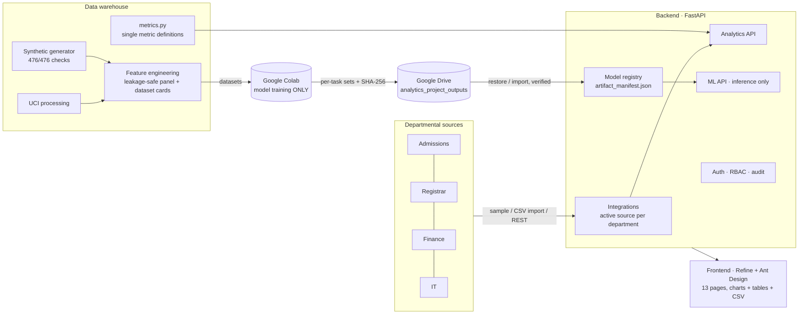
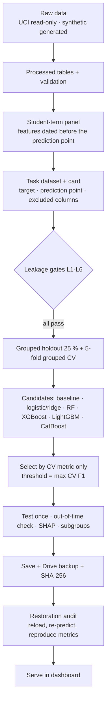

# University Institutional Analytics Dashboard: presentation and demonstration

This deck is written one slide per section, and each slide comes with speaker notes. The diagrams use Mermaid: they render on GitHub and in VS Code, and can be pasted into mermaid.live to export them as images.

---

## Slide 1: Project overview
- **One platform.** It covers Admissions, Registrar, Finance and IT.
- **One definition of each metric.**
  - Enrolment, performance, retention, graduation, admissions, finance and IT.
- **AI that is honest about itself.** There are 20 predictive and analytical tasks: risk, retention, graduation, admissions, forecasting and segmentation.
  - Every model is leakage-gated and trained in Google Colab.
  - Every model is backed up with SHA-256 checks.
- **Built for governance.**
  - Two roles: ADMIN and MANAGEMENT.
  - An audit log.
  - Pseudonymous student-level outputs.
- **Data.**
  - Public UCI data: 4,424 students. Used only for benchmarks.
  - A **synthetic** institution of 5,000 students, 2016–2026. Every result from it is labelled demonstration data.

*Notes:* say early and plainly that the institutional results are demonstrations on synthetic data.

---

## Slide 2: System architecture


*Notes:* the backend never trains a model. Training happens only in Colab, and artifacts come back to the backend through a verified manifest.

---

## Slide 3: Data and model workflow


---

## Slide 4: Dashboard features
| Area | What users can do |
|---|---|
| Institutional analytics | Use nine filters; compare terms; compare Fall→Fall, Spring→Spring and Summer→Summer retention; view graduation-rate windows, the admissions funnel, finance holds and IT status |
| Predictions | Score a single student (with explanations), a CSV batch from a template, or a cohort of current students; see risk bands with the original and supplementary thresholds |
| Forecasting | View enrolment, admissions and course-demand forecasts with 80 % intervals, backtest errors and caveats |
| Segmentation | View cluster profiles and a data-quality anomaly list (needs the student-level permission) |
| Governance | Model evaluation and restoration status, prediction history, reports and exports, users and roles, integrations, sync runs, audit log, settings |

---

## Slide 5: Key results (test sets)
| Task | Selected model | Result |
|---|---|---|
| Next-term academic risk (synthetic) | CatBoost | ROC-AUC **0.985**, PR-AUC 0.844 |
| UCI dropout at end of year 1 | Logistic regression | ROC-AUC **0.933**, F1 0.808 |
| Graduation within window (synthetic) | Random forest | ROC-AUC 0.824 |
| Next-term GPA (synthetic) | Random forest | RMSE 0.451, R² 0.535 |
| Enrolment headcount forecast | XGBoost on lags | WAPE **0.022** (seasonal-naive 0.049) |
| Retention (6 tasks) | Mixed | ROC-AUC 0.66–0.68 (**weak**) |
| Admissions acceptance | XGBoost | ROC-AUC 0.631 (**weak**) |
| Segmentation | k-means, k = 4 | Silhouette 0.190 (**weak structure**) |

*Notes:* the weak results are shown on purpose. The pipeline reports them; it does not hide them.

---

## Slide 6: Limitations
- **Synthetic data.** The models partly re-learn the generator's rules. Real-world validity is unknown.
- **UCI data.** One Portuguese institution, so the results do not transfer.
- **Fairness.** In the 2-year dropout model, undergraduate recall is 0.34, against 0.68 for Master's. Per-level thresholds and monitoring would be needed before any real use.
- **Cox models.** Some covariates violate the proportional-hazards assumption. The models give relative hazards only.
- **Forecasts.** ETS intervals are too narrow, and the series starts with a warm-up artefact.
- **Integrations.** No live departmental APIs are connected yet.
- **Cross-platform serialisation.** One Colab XGBoost pickle does not load on Windows. It is served through its verified portable export, which gives identical predictions.

---

## Slide 7: Provenance and verification
- **Where the 20 tasks were trained.** All 20 were trained in Google Colab.
  - Eight Batch 1 tasks were first trained locally. They were retrained in Colab on 2026-11-11 and all 8 passed every check.
  - Their selected models are unchanged, and 7 of 8 reproduce their metrics exactly.
- **Test results.**

  | Check | Result |
  |---|---|
  | Restoration audit | 32 / 32 PASS |
  | Backend tests | 34 / 34 |
  | Frontend tests | 19 / 19 |
  | Live end-to-end | 69 / 69, both roles |
  | Data-warehouse tests in Colab | 87 pass, 2 fail on stale forecasting outputs in the working copy |

- **Backups.** The original Drive ZIP backups were verified unchanged, by SHA-256.

---

## Demonstration script (about 10 minutes)
1. **Start the server.**
   ```powershell
   cd backend
   ..\.venv\Scripts\python -m uvicorn app.main:app --port 8000
   ```
   Open <http://127.0.0.1:8000>.
2. **Sign in as `manager`.** The initial password is in `backend/var/initial_credentials.txt`. Show the forced password change.
3. **Overview.** Point out the KPI row and the data-source banner, which says *synthetic demonstration data*.
4. **Enrolment.**
   - Filter Level = Undergraduate and Delivery = Online.
   - Toggle between **Chart** and **Table**, then download the CSV.
   - Compare two terms.
5. **Retention.** Switch Fall→Fall to Summer→Summer and explain `CONTINUING_SKIPPED_OPTIONAL_SUMMER`.
6. **Predictions.**
   - Run *Next-term academic risk* with the pre-filled example and tick *Explain*.
   - Show the risk band, both thresholds and the top factors (associations, not causes).
   - Upload the CSV template as a batch.
7. **Forecasting.** Show the enrolment forecast with its 80 % band and the backtest WAPE against seasonal-naive.
8. **Model evaluation.** Show the metrics and the restoration status. Open an ROC/PR figure.
9. **Sign in as `admin`.**
   - Show the audit log: it records the manager's predictions and downloads.
   - Create a custom role.
   - Show Integrations: upload a CSV that fails validation, and show that nothing is stored.
10. **Close with the limitations slide.**
